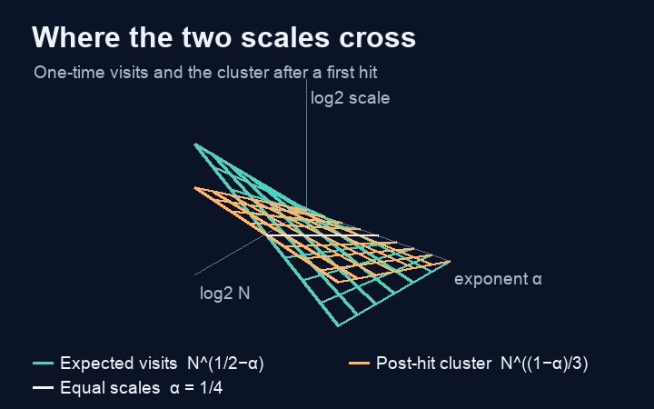

# The Recurrence Threshold for Real-Power Rademacher Walks

  

**Q1600.** Bhattacharya, Crane and Johnston ask on page 6 how the Rademacher walk with exact real steps j^α behaves for 0 < α ≤ 1/2. [Problem source](https://arxiv.org/pdf/2510.24568v2#page=6)

For independent symmetric signs and exact real weights j^α, with 0 < α ≤ 1/2, almost surely every nonempty open interval is visited infinitely often when α ≤ 1/4. When 1/4 < α ≤ 1/2, the absolute walk position tends to infinity almost surely.

[Read the paper](paper/manuscript.pdf) · [Proof](proof/PROBLEM_AND_PROOF.md) · [Version DOI](https://doi.org/10.5281/zenodo.24588799) · [Citation](CITATION.cff)

## Worked example

At α = 1/4 both powers governing expected visits and guaranteed cluster size are N^(1/4), and the recurrence second moment has no extra logarithmic loss. At α = 2/5 the powers are N^(1/10) and N^(1/5), giving a dyadic hit bound of order N^(−1/10).

[Download the offline 3D explorer](https://raw.githubusercontent.com/DannyExperiments/rademacher-power-threshold/v1.0.0/visualization/visit-and-cluster-scales-explorer.zip). Extract it and open `index.html`. [Figure guide](visualization/README.md)

## Proof and verification

A Fourier estimate for short blocks bounds joint visits in the recurrence range, including the critical exponent. Conditional first and second moments followed by martingale convergence give visits to every interval. On the transient side, the first hit starts a cluster: an even block of balanced signs has conditional variance of order at most N^(2α−2)ℓ³, producing many expected visits nearby. Dividing expected visits by the conditional cluster size gives the dyadic bound O(N^((1−4α)/6)).

The exact replay checks 49 balanced-sign variance fixtures, 40 rational exponent fixtures, and the critical equality. These small exact tests illustrate specific steps. The paper gives the analytic proof.

[Reproducibility](REPRODUCIBILITY.md) · [Prior work](audits/public_safe_reports/LITERATURE_AUDIT.md) · [Scope](CLAIM_SCOPE_AND_LIMITATIONS.md) · [AI disclosure](AI_DISCLOSURE.md)
